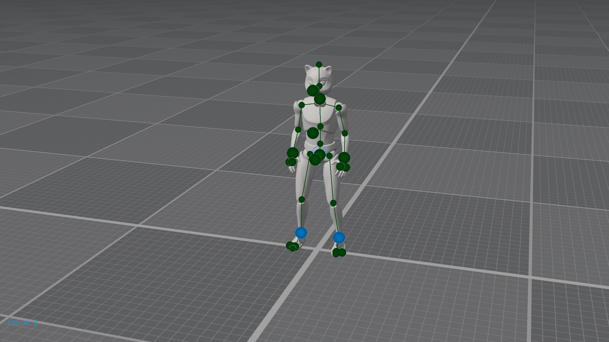
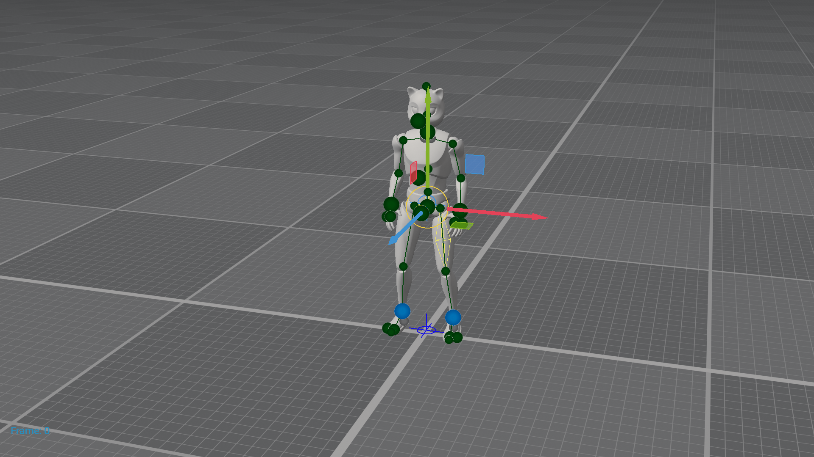
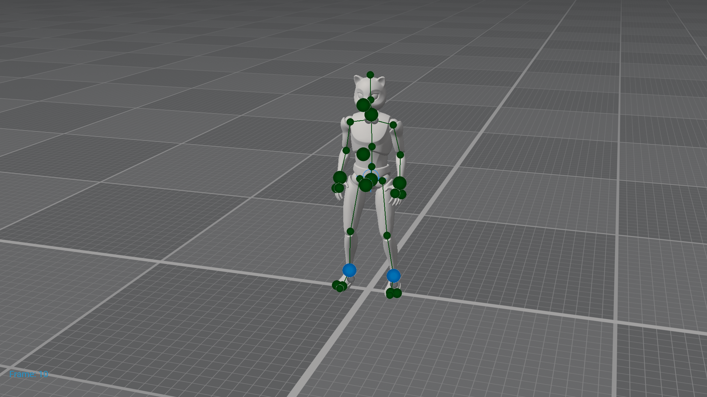
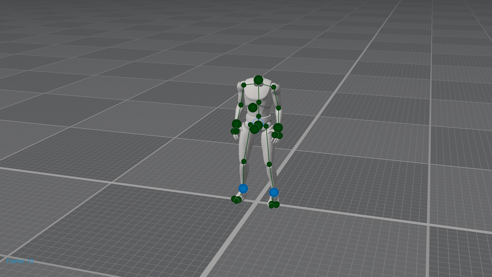
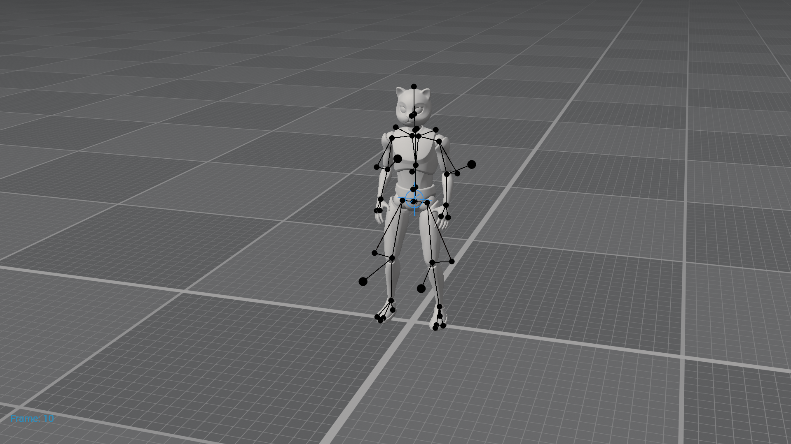
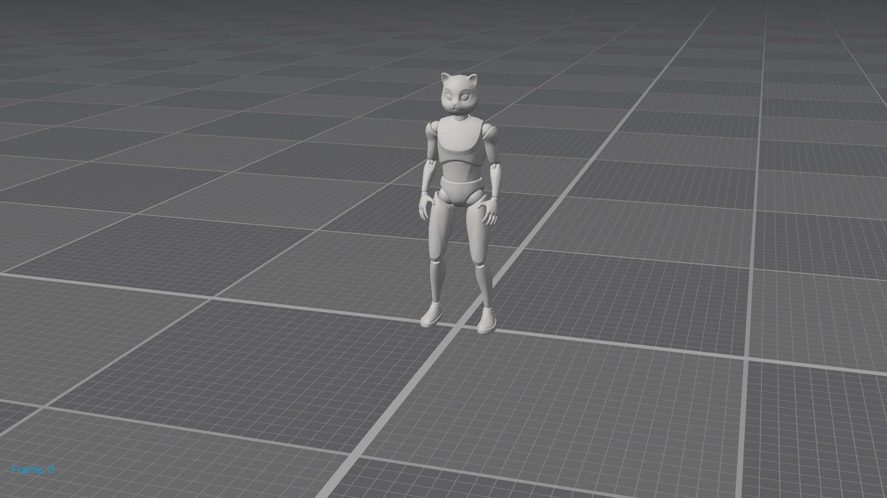
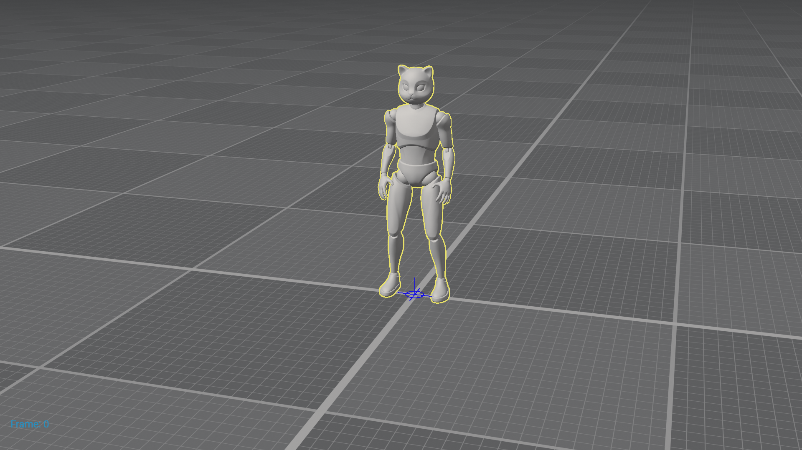

# cascadeur-mcp 1.0.0 — full capability proof

Live run against **Cascadeur 2026.2.3** through the real MCP stdio server
(`cascadeur-mcp 1.0.0`, 45 tools registered).
Raw results: [proof.json](proof.json).

## How this was captured

`scripts/live_proof_mcp.py` starts `cascadeur-mcp` over stdio (the way a real client
does), performs the MCP handshake, calls **every registered tool**, and captures the
visible result of the interesting steps with `screenshot_viewport` into
[`screenshots/`](screenshots/). The FBX and .casc files written during the run are in
[`artifacts/`](artifacts/).

## Tool coverage

All **45 registered tools** were called through MCP
(45 unique tools; 63/63
calls returned success). `duplicate_object` is exercised through Cascadeur's bundled
duplicate command (see screenshot 07).

| Tool | Status | Detail |
|---|---|---|
| `get_script_server_status` | pass ×1 | {'connected': True, 'url': 'http://127.0.0.1:8766', 'expected_runtime_version': '1.0.0', 'server_version': '0.3.1', 'queued': 0, 'pong': True, 'runtim |
| `csc://schema` | pass ×1 | 106448 bytes |
| `load_scene` | pass ×1 | {'path': 'C:/Users/sandv/AppData/Local/Cascadeur/samples/Cascy.casc', 'loaded': True, 'method': 'DataSourceManager.load_scene'} |
| `get_scene_info` | pass ×2 | {'has_scene': True, 'current_frame': 0, 'object_count': 67, 'layer_count': 1, 'selection_count': 0, 'scene_name': 'untitled.casc'} |
| `get_current_frame` | pass ×1 | {'current_frame': 0} |
| `list_objects` | pass ×3 | {'objects': '<list len=68>', 'count': 68} |
| `get_object_hierarchy` | pass ×1 | {'objects': '<list len=289>', 'count': 289} |
| `list_layers` | pass ×1 | {'layers': '<list len=13>', 'count': 13, 'frames_count': 1} |
| `set_selection` | pass ×2 | {'requested': ['Cascy_mesh'], 'resolved_count': 1, 'missing': []} |
| `get_selection` | pass ×1 | {'selected': [{'id': '0006f104-e2fd-425b-b050-56aea53dc7f0', 'name': 'thigh_l'}, {'id': 'ad915519-cc6c-49df-be58-8f223d2735fc', 'name': 'pelvis'}], 'c |
| `selection_extend` | pass ×1 | {'added': ['calf_l'], 'missing': [], 'selection_count': 3} |
| `selection_subtract` | pass ×1 | {'removed': ['calf_l'], 'missing': [], 'selection_count': 2} |
| `selection_filter` | pass ×1 | {'pattern': 'pelvis', 'mode': 'contains', 'matched_count': 11, 'matched_names': ['pelvis', 'pelvis_Box', 'pelvis_MainPoint', 'pelvis_AdditionalPoint', |
| `clear_selection` | pass ×1 | {'cleared': True} |
| `get_object_transform` | pass ×1 | {'object': 'pelvis', 'frame': 0, 'position': [0.0009238154743798077, 95.63358306884766, -5.191793918609619], 'rotation': [4.160368916927837e-06, -0.99 |
| `list_object_attributes` | pass ×1 | {'object': 'pelvis', 'attributes': [{'name': 'pelvis.Export Rotate Animation'}, {'name': 'pelvis.Actual'}, {'name': 'pelvis.In'}, {'name': 'pelvis.Out |
| `read_telemetry` | pass ×1 | {'telemetry': {'pelvis': {'0': {'position': [0.0009238154743798077, 95.63358306884766, -5.191793918609619], 'rotation': [4.160368916927837e-06, -0.999 |
| `read_telemetry_range` | pass ×1 | {'telemetry': '<dict len=2>', 'frames': [0, 1, 2, 3, 4, 5], 'missing': [], 'node_names': ['Local Position', 'Local Rotation']} |
| `set_current_frame` | pass ×1 | {'requested': 10, 'current_frame': 0} |
| `get_keyframes` | pass ×1 | {'layer_id': 'f65688f0-d327-4f14-939a-dda6e24df94b', 'key_frame_indices': [0], 'count': 1} |
| `add_keyframe` | pass ×1 | {'layer_id': 'f65688f0-d327-4f14-939a-dda6e24df94b', 'frame': 12, 'added': True} |
| `remove_keyframe` | pass ×1 | {'layer_id': 'f65688f0-d327-4f14-939a-dda6e24df94b', 'frame': 12, 'removed': True} |
| `bake_range` | pass ×1 | {'layer_id': 'f65688f0-d327-4f14-939a-dda6e24df94b', 'frame_start': 0, 'frame_end': 3, 'baked_count': 4} |
| `set_controller_position` | pass ×1 | {'controller': 'pelvis', 'obj_id': 'ad915519-cc6c-49df-be58-8f223d2735fc', 'applied': {'position': True, 'rotation': False, 'frame': 10, 'position_new |
| `set_controller_rotation` | pass ×1 | {'controller': 'pelvis', 'obj_id': 'ad915519-cc6c-49df-be58-8f223d2735fc', 'applied': {'position': False, 'rotation': True, 'frame': 10}, 'attrs_updat |
| `set_controller_scale` | pass ×1 | {'controller': 'pelvis', 'obj_id': 'ad915519-cc6c-49df-be58-8f223d2735fc', 'applied': {'frame': 10, 'scale_new': [1.0, 1.0, 1.0], 'scale_set': True},  |
| `undo` | pass ×2 | {'invoked': 'Scene.Undo'} |
| `redo` | pass ×1 | {'invoked': 'Scene.Redo'} |
| `get_active_layer` | pass ×1 | {'active_layer_id': 'f65688f0-d327-4f14-939a-dda6e24df94b', 'active_layer_name': 'Head', 'layer_ids': ['aa1894c0-1919-45c4-8a0d-bbe31201e615', 'e52f45 |
| `set_active_layer` | pass ×1 | {'layer_id': 'f65688f0-d327-4f14-939a-dda6e24df94b', 'set': True, 'frame_range': [0, 10], 'semantics': 'timeline-layer-selection'} |
| `set_layer_visible` | pass ×2 | {'layer_id': 'f65688f0-d327-4f14-939a-dda6e24df94b', 'visible': True, 'method': 'set_visible_for_layer'} |
| `set_layer_locked` | pass ×2 | {'layer_id': 'f65688f0-d327-4f14-939a-dda6e24df94b', 'locked': False, 'method': 'set_locked_for_layer'} |
| `add_layer` | pass ×1 | {'name': 'proof_layer', 'layer_id': 'f8e3e419-ab37-48e9-b43e-ac54d7abebea', 'created': True} |
| `delete_layer` | pass ×1 | {'layer_id': 'f8e3e419-ab37-48e9-b43e-ac54d7abebea', 'deleted': True, 'method': 'delete_layer'} |
| `call_action` | pass ×1 | {'action_id': 'Scene.Undo', 'invoked': True} |
| `run_autoposing` | pass ×1 | {'invoked': 'AutoPosingTool.AutoPosing'} |
| `run_autophysics` | pass ×1 | {'invoked': 'AutoPhysicsTool.Snap to Auto Physics', 'converged': True} |
| `save_scene` | pass ×1 | {'path': 'C:/Users/sandv/Desktop/poppet/docs/proof/artifacts/cascy-proof.casc', 'method': 'view.Scene.save', 'exists': True, 'size_bytes': 4077167, 's |
| `export_fbx` | pass ×1 | {'path': 'C:/Users/sandv/Desktop/poppet/docs/proof/artifacts/cascy.fbx', 'exists': True, 'size_bytes': 3106976, 'settings': {'mode': 'Binary', 'up_axi |
| `new_scene` | pass ×2 | {'created': True, 'method': 'SceneManager.create_application_scene'} |
| `import_fbx` | pass ×1 | {'path': 'C:/Users/sandv/Desktop/poppet/docs/proof/artifacts/cascy.fbx', 'target': 'scene', 'imported': True} |
| `run_script` | pass ×1 | {'ok': True, 'value': '2', 'messages': []} |
| `execute_csc_code` | pass ×2 | {'repr': 'None'} |
| `delete_object` | pass ×2 | {'deleted': 'Cascy_mesh(1)', 'obj_id': '3adfd96e-b219-41e9-98a6-ae5b5ce3e92c', 'method': 'ModelEditor.delete_objects'} |
| `duplicate_object` | pass ×1 | {'source': 'Cascy_mesh', 'source_id': '22699336-a5dd-48e2-a8f4-d4905c76c5fe', 'new_objects': [{'id': '3adfd96e-b219-41e9-98a6-ae5b5ce3e92c', 'name': ' |

## Screenshots

### 01 cascy loaded

*2211370 bytes, 1920x1080 — Cascy sample scene loaded via `load_scene` — 289 objects, 13 layers.*

### 02 selection

*2214519 bytes, 1920x1080 — `set_selection` on thigh/pelvis — selection outlines visible in the viewport.*

### 03 keyframe pose

*2211582 bytes, 1920x1080 — playhead at frame 10 after `set_controller_position/rotation/scale` writes.*

### 04 layer hidden

*2207925 bytes, 1920x1080 — `set_layer_visible(false)` on the Head layer — the head is gone.*

### 05 autopose

*2205137 bytes, 1920x1080 — after `run_autoposing` snapped the current frame.*

### 06 imported fbx

*2155629 bytes, 1920x1080 — `new_scene` + `import_fbx(target=scene)` re-imported the exported Cascy FBX (67 objects).*

### 07 duplicate object

*2160542 bytes, 1920x1080 — `duplicate_object` created a duplicate through Cascadeur's bundled duplicate command; the new object is shown selected.*

### 08 final viewport

*2160490 bytes, 1920x1080 — final state after delete/undo/cleanup.*
